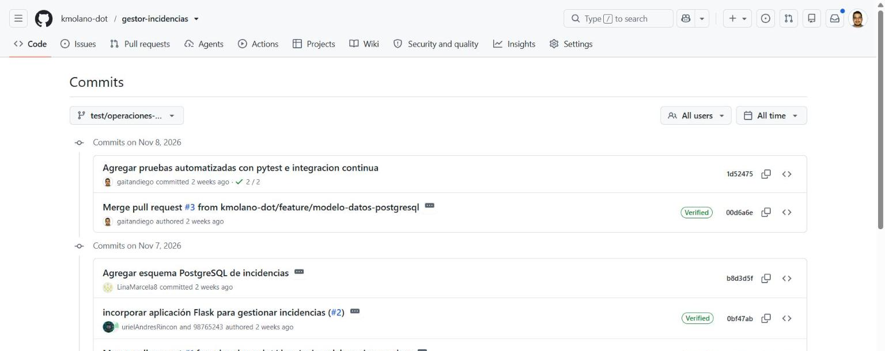
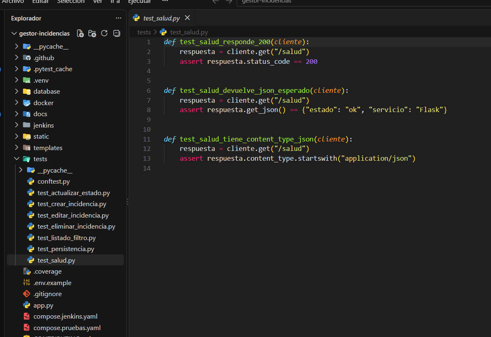
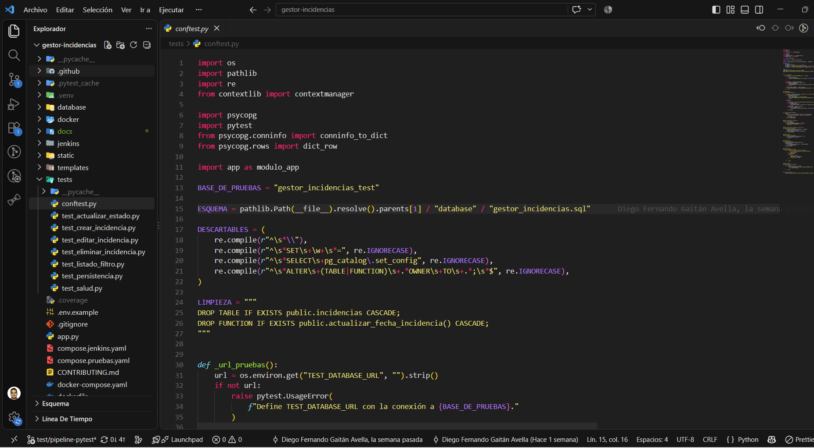
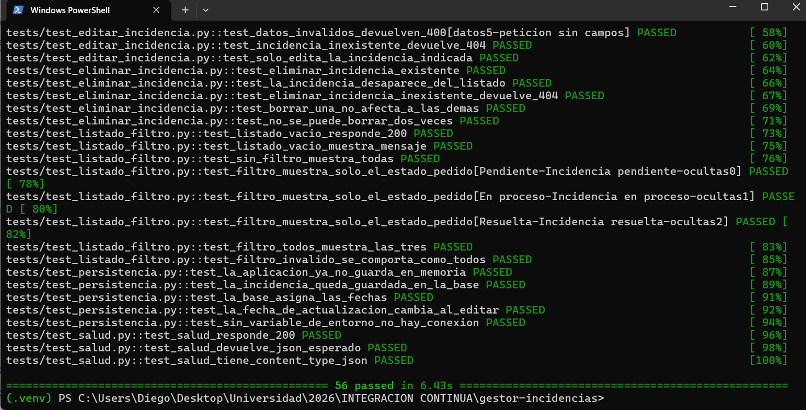
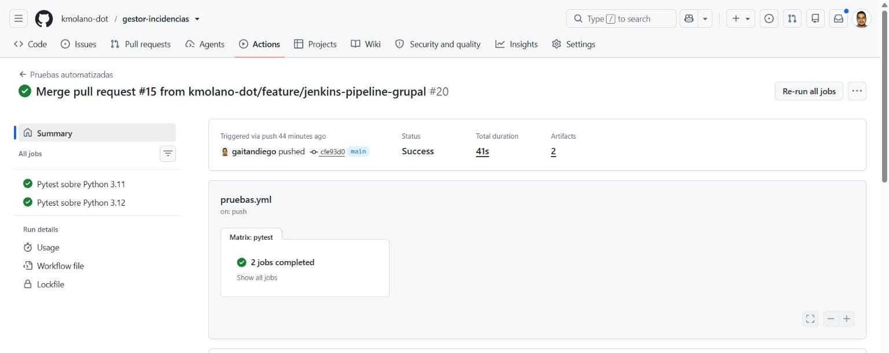
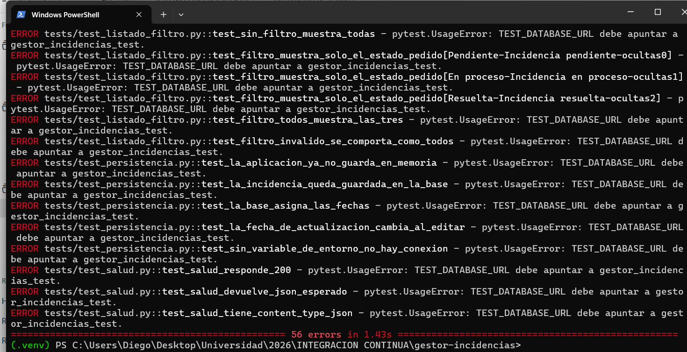
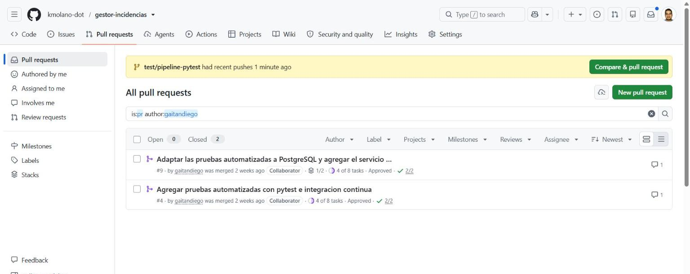

# Pruebas automatizadas con Pytest — Gestor de Incidencias

**Responsable:** Diego Fernando Gaitán Avella
**Proyecto:** Gestor de Incidencias
**Fecha de las evidencias:** 8 y 9 de noviembre de 2026
**Alcance:** diseño y escritura de la suite de pruebas, su adaptación a PostgreSQL y la configuración de la integración continua en GitHub Actions. No incluye Jenkins, que corresponde a la segunda entrega.

## Paso 1. Preparar la rama de trabajo

Según el reparto acordado en `CONTRIBUTING.md`, me correspondieron las pruebas automatizadas. Creé la rama indicada para no trabajar sobre `main`.

```bash
git switch main
git pull origin main
git switch -c test/operaciones-incidencias
```



*Figura 1. Creación de la rama de trabajo.*

## Paso 2. Decidir qué se iba a probar

Antes de escribir código revisé las rutas de `app.py` y armé un archivo de pruebas por cada operación del gestor. La idea era que al leer el nombre del archivo se supiera qué cubre, y que un fallo señalara de una vez la operación rota.

| Archivo | Qué cubre | Funciones |
| --- | --- | --- |
| `test_crear_incidencia.py` | Registro de incidencias y validación de datos | 9 |
| `test_listado_filtro.py` | Listado y filtro por estado | 6 |
| `test_editar_incidencia.py` | Edición de una incidencia existente | 5 |
| `test_eliminar_incidencia.py` | Eliminación de incidencias | 5 |
| `test_persistencia.py` | Que los datos queden guardados en la base | 5 |
| `test_actualizar_estado.py` | Cambio de estado | 4 |
| `test_salud.py` | Ruta de comprobación del servicio | 3 |

En total quedaron **37 funciones de prueba**. Varias usan `@pytest.mark.parametrize` para repetir el mismo caso con distintos datos sin duplicar código.



*Figura 2. Estructura de la carpeta `tests`.*

## Paso 3. Escribir las fixtures compartidas

Para no repetir la preparación en cada prueba dejé las piezas comunes en `tests/conftest.py`:

| Fixture | Para qué sirve |
| --- | --- |
| `cliente` | Cliente de pruebas de Flask, con la base vacía antes y después |
| `conexion` | Conexión directa a la base de pruebas |
| `crear_incidencia` | Crea una incidencia de ejemplo sin repetir el formulario |
| `leer_incidencias` | Devuelve las filas de la tabla para comprobar resultados |
| `esquema` | Carga el esquema SQL una vez por sesión |

Cada prueba empieza con la tabla vacía porque la fixture `cliente` ejecuta un `TRUNCATE ... RESTART IDENTITY` antes y después. Así los identificadores siempre arrancan en 1 y una prueba no depende de lo que hizo la anterior.



*Figura 3. Preparación compartida de las pruebas.*

## Paso 4. Configurar Pytest

Agregué `pytest.ini` para que las pruebas se puedan ejecutar con un solo comando desde la raíz del proyecto.

```ini
[pytest]
pythonpath = .
testpaths = tests
addopts = -v --strict-markers
```

Y sumé las dependencias correspondientes a `requirements.txt`:

```
pytest>=8.0
pytest-cov>=5.0
```



*Figura 4. Las pruebas pasando en el equipo local.*

## Paso 5. Configurar la integración continua en GitHub Actions

Creé el flujo `.github/workflows/pruebas.yml` para que las pruebas se ejecuten solas en cada `push` a `main` y en cada pull request. El flujo levanta un servicio PostgreSQL, instala las dependencias y ejecuta Pytest con cobertura sobre dos versiones de Python.

```yaml
on:
  push:
    branches: [main]
  pull_request:

strategy:
  matrix:
    version-python: ["3.11", "3.12"]
```

Los resultados quedan guardados como artefactos (`resultados-pruebas.xml` y `coverage.xml`) para poder consultarlos después de cada ejecución.



*Figura 5. Ejecución automática en las dos versiones de Python.*

## Paso 6. Adaptar las pruebas a PostgreSQL

Cuando Lina terminó el modelo de datos y Silva la dockerización, las pruebas tenían que dejar de trabajar contra memoria y pasar a la base real. Esto obligó a reescribir buena parte de `conftest.py`.

**Incidencia encontrada.** El riesgo evidente era que una ejecución de pruebas borrara la base de desarrollo, porque las fixtures hacen `TRUNCATE`. Para evitarlo, la conexión de pruebas solo se acepta si cumple tres condiciones:

1. La variable `TEST_DATABASE_URL` tiene que existir; si falta, Pytest se detiene con un mensaje claro.
2. La cadena debe apuntar a la base `gestor_incidencias_test`, y no a cualquier otra.
3. Ya conectado, se vuelve a preguntar a PostgreSQL en qué base está parado y se compara.

```python
if parametros.get("dbname") != BASE_DE_PRUEBAS:
    raise pytest.UsageError(f"TEST_DATABASE_URL debe apuntar a {BASE_DE_PRUEBAS}.")
```

La tercera comprobación puede parecer repetida, pero cubre el caso de que la cadena diga una cosa y la conexión termine en otra.



*Figura 6. Las pruebas se niegan a ejecutarse contra una base distinta.*

## Paso 7. Integrar los cambios

Ambos aportes se integraron mediante pull request siguiendo el flujo acordado en `CONTRIBUTING.md`.

| Pull request | Commit | Contenido |
| --- | --- | --- |
| #4 | `1d52475` | Suite inicial de pruebas y flujo de GitHub Actions |
| #9 | `26bf3f7` | Adaptación a PostgreSQL y servicio de base en CI |



*Figura 7. Solicitudes de incorporación revisadas por el equipo.*

## Resultado y límites de esta entrega

Quedó una suite de 37 pruebas que cubre las operaciones del gestor y que se ejecuta sola en cada cambio del repositorio, con informe de resultados y de cobertura.

Conviene aclarar dos cosas:

- La automatización de esta etapa corre en **GitHub Actions**, no en Jenkins. Jenkins entra en la segunda entrega.
- El commit `ccf144f` de Kevin (pull request #10) hizo un ajuste posterior sobre `tests/conftest.py` para terminar de aislar la base. Ese cambio es suyo, no mío.

**Seguridad:** las credenciales de la base de pruebas no están escritas en el repositorio. En GitHub Actions se arman dentro del propio flujo con el usuario temporal del servicio, y en local se toman de un archivo `.env` que está excluido por `.gitignore`.
