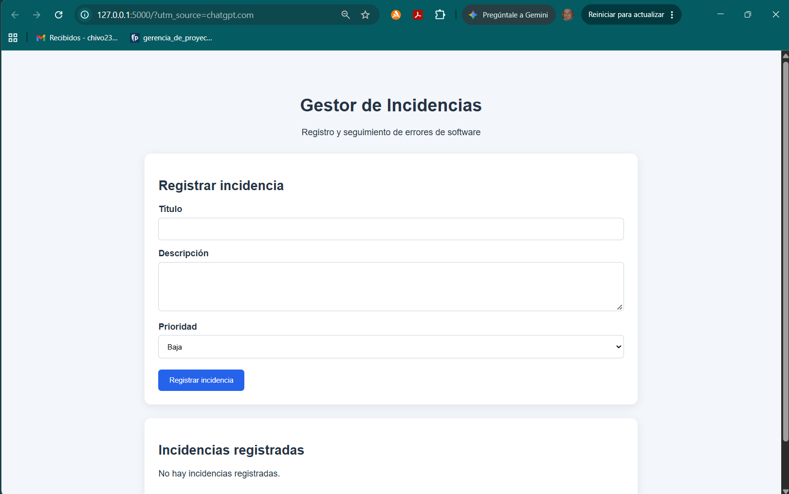
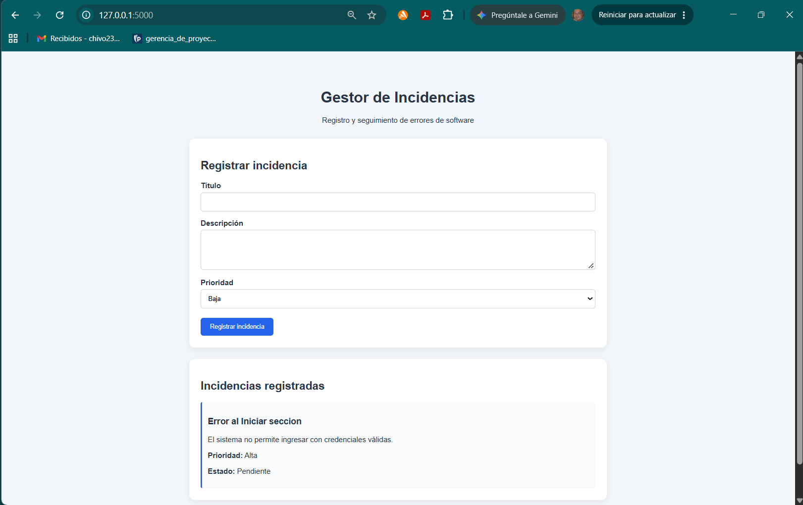
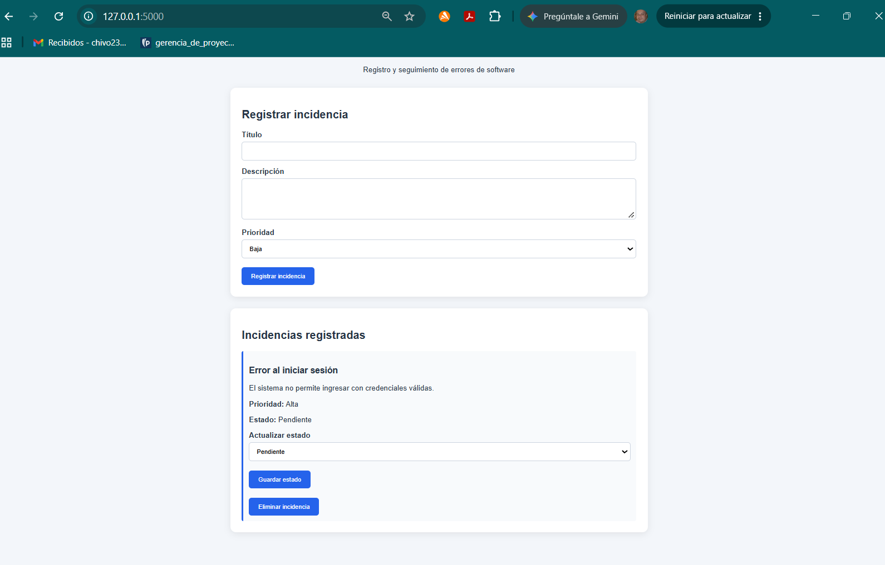
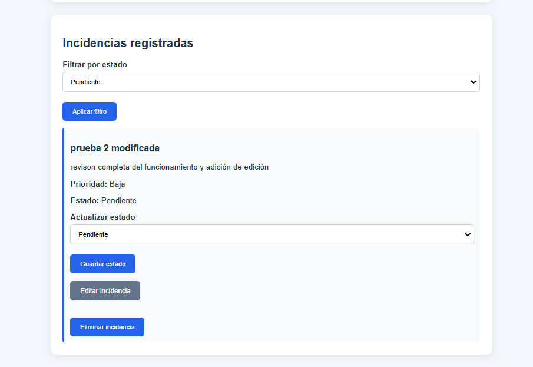
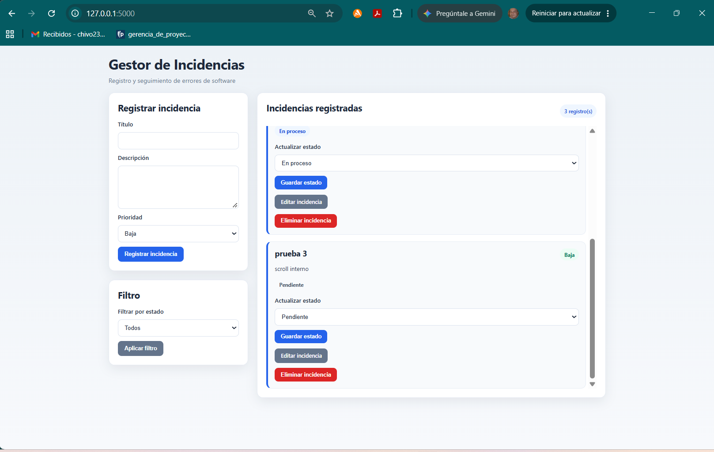
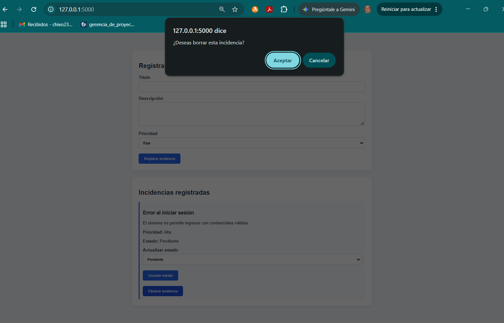
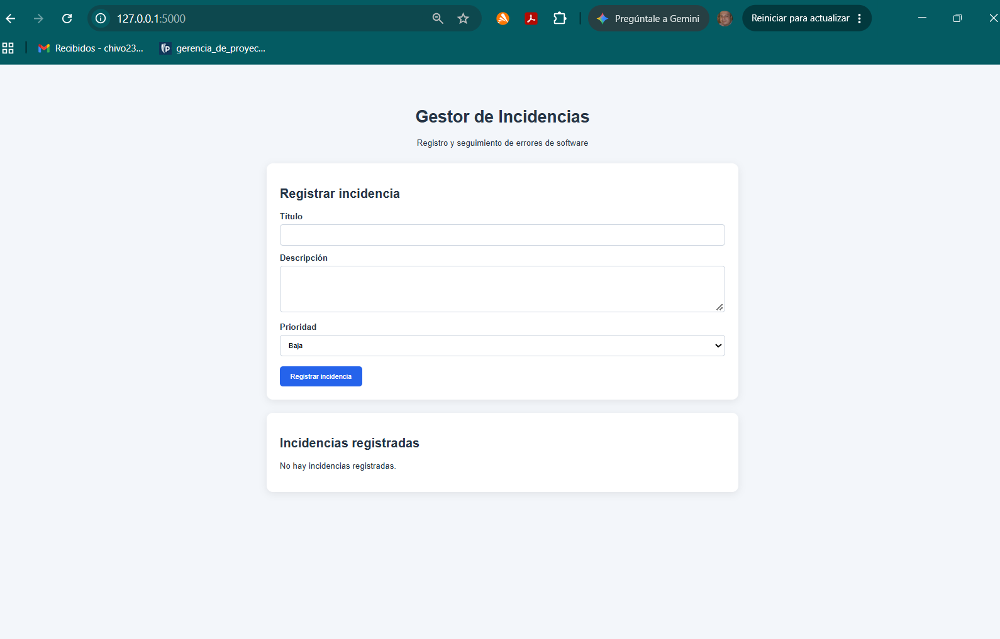
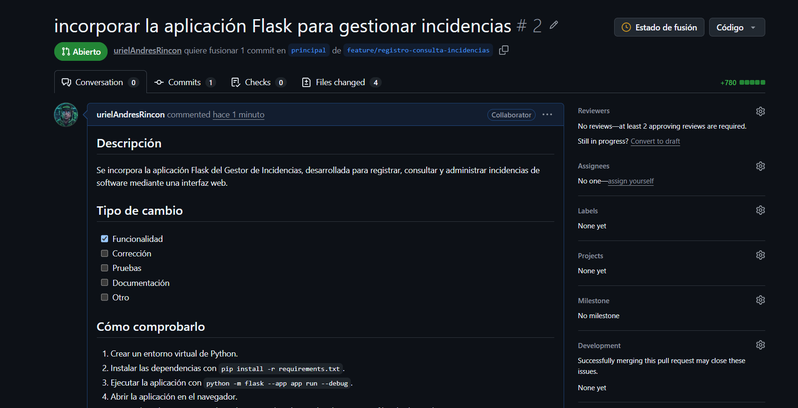

# Desarrollo de la aplicación Gestor de Incidencias con Python y Flask

**Responsable:** Uriel Andrés Rincón  
**Actividad:** Desarrollo de la aplicación web y su interfaz.  
**Etapa:** Primera entrega — aplicación Flask.  
**Evidencia en GitHub:** [PR #2 — Incorporar aplicación Flask para gestionar incidencias](https://github.com/kmolano-dot/gestor-incidencias/pull/2) (integrado el 7 de noviembre de 2026).

## ¿Qué hice?

Desarrollé la aplicación web **Gestor de Incidencias** utilizando **Python y Flask**, con una interfaz para registrar y administrar problemas de software. En esta primera versión se utilizó **almacenamiento temporal en memoria** para verificar las funciones de la aplicación antes de integrar una base de datos.

**Alcance de este aporte:** el diseño de la aplicación Flask, sus rutas, validaciones, interfaz HTML y estilos CSS. **La configuración e integración de PostgreSQL pertenecen a una actividad distinta y se documentarán por separado**, en el apartado de Lina. Este archivo no describe ese trabajo como propio.

## Pasos realizados y capturas

### Paso 1. Crear la estructura de la aplicación y la interfaz

Se prepararon los archivos necesarios para ejecutar la aplicación web y mostrar un formulario de registro de incidencias. El punto de entrada es `app.py`; la plantilla HTML y los estilos se encuentran en sus respectivas carpetas.

**Archivos incorporados en el PR #2:** `app.py`, `requirements.txt`, `templates/index.html` y `static/styles.css`.

*Figura 1. Formulario inicial del Gestor de Incidencias. Captura recuperada del informe grupal de la primera entrega.*

### Paso 2. Implementar el registro de incidencias

Se programó el formulario para registrar un **título**, una **descripción** y una **prioridad** (Baja, Media o Alta). Una nueva incidencia inicia con el estado **Pendiente**. También se incorporaron validaciones básicas para impedir títulos o descripciones vacíos y rechazar prioridades no permitidas.

*Figura 2. Ejemplo de una incidencia visible en el listado. Captura del informe grupal.*

### Paso 3. Mostrar y consultar las incidencias

Se desarrolló un listado que muestra los registros y permite revisar su título, descripción, prioridad y estado. También se agregó la opción de filtrar el listado por estado.

*Figura 3. Listado de incidencias con acciones disponibles. Captura del informe grupal.*

### Paso 4. Modificar información y actualizar el estado

Se incorporaron opciones para editar los datos de una incidencia y cambiar su estado entre **Pendiente**, **En proceso** y **Resuelta**. El formulario permite guardar los cambios desde la interfaz.

*Figura 4. Registro de prueba modificado, controles de edición y filtro por estado. Captura del informe grupal.*

*Figura 5. Vista general de la interfaz, el filtro y las acciones sobre los registros. Captura del informe grupal.*

### Paso 5. Eliminar incidencias con confirmación

Se añadió una acción para eliminar una incidencia y una confirmación en el navegador antes de continuar con el borrado.

*Figura 6. Confirmación mostrada antes de eliminar un registro. Captura del informe grupal.*

*Figura 7. Vista del listado vacío, incluida como evidencia de la interfaz. Captura del informe grupal.*

### Paso 6. Publicar el desarrollo en GitHub

Los archivos de la aplicación se incorporaron en una rama de trabajo y se presentaron mediante el [PR #2](https://github.com/kmolano-dot/gestor-incidencias/pull/2). La descripción del pull request registra que las funciones de creación, consulta, edición, cambio de estado, eliminación y filtrado se comprobaron **manualmente** en el entorno local.

*Figura 8. Captura del pull request de la aplicación Flask, recuperada del informe grupal.*

## Resultado de este aporte

Se entregó una **aplicación web funcional con Python y Flask**, con interfaz, operaciones de gestión de incidencias y comprobaciones manuales documentadas en el PR #2. La primera versión utilizó una lista en memoria; la persistencia con PostgreSQL fue una etapa posterior que se documentará en el aporte correspondiente.

## Archivos y referencias de consulta

- [PR #2 — Desarrollo de la aplicación Flask](https://github.com/kmolano-dot/gestor-incidencias/pull/2).
- [Código actual de `app.py`](https://github.com/kmolano-dot/gestor-incidencias/blob/main/app.py) (puede incluir cambios posteriores de otros trabajos).
- [Plantilla HTML actual](https://github.com/kmolano-dot/gestor-incidencias/blob/main/templates/index.html).
- [Estilos CSS actuales](https://github.com/kmolano-dot/gestor-incidencias/blob/main/static/styles.css).

## Nota sobre las capturas

Las ocho capturas de este archivo se **recuperaron del documento grupal de la primera entrega**. Son evidencias visuales de la interfaz y del trabajo en GitHub; no son capturas obtenidas mediante una ejecución nueva. No todas permiten determinar el momento exacto en que se tomaron. Para la autoría y el alcance del desarrollo, la referencia principal es el **PR #2**.
