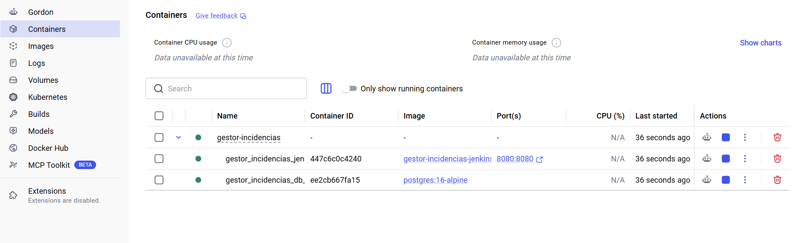
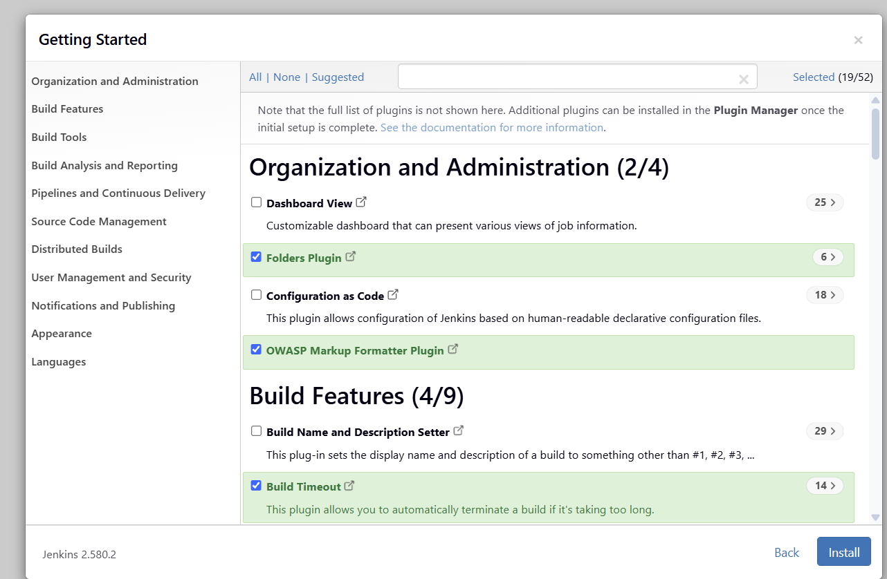
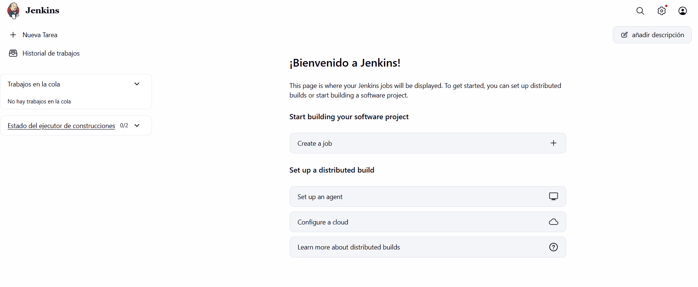
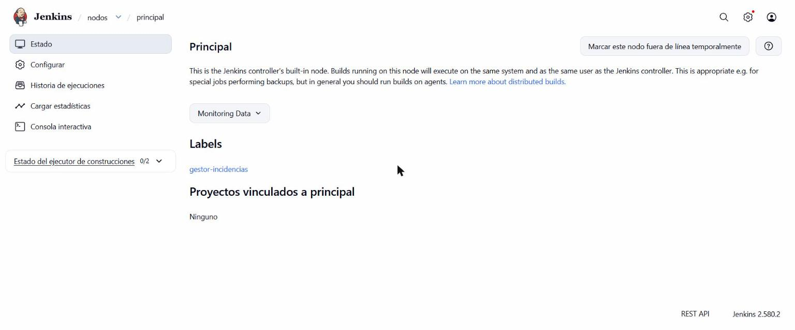
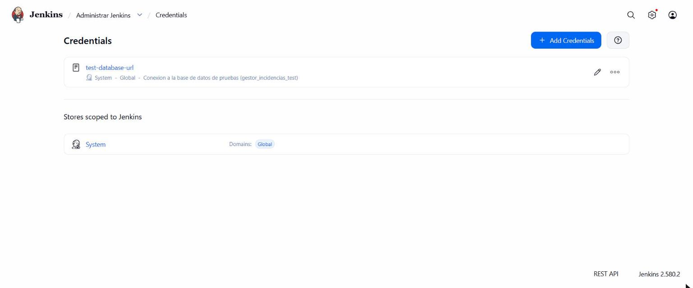
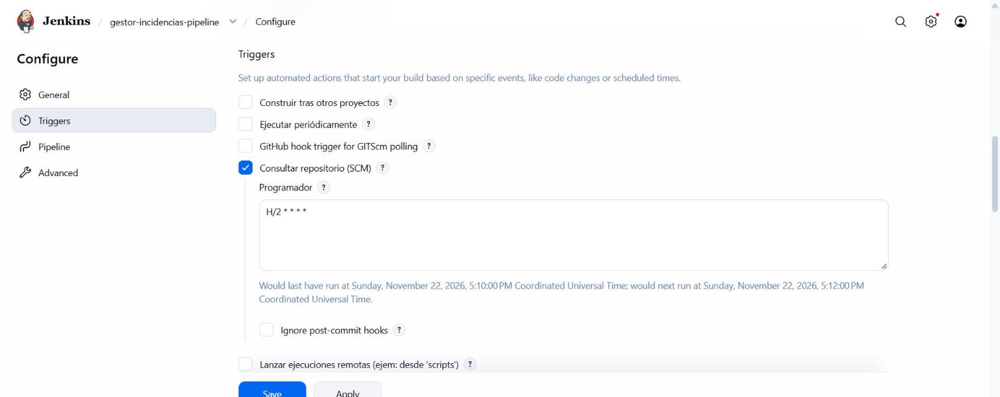
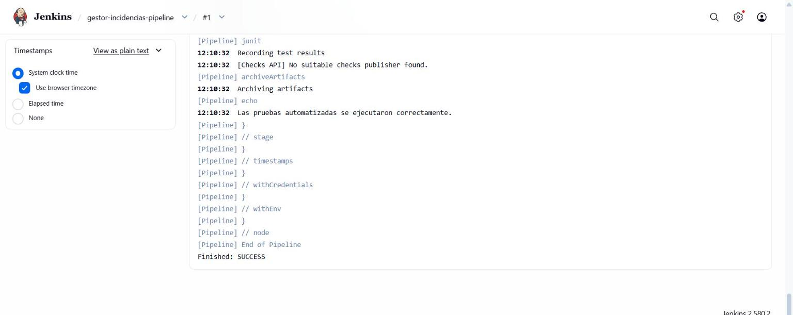
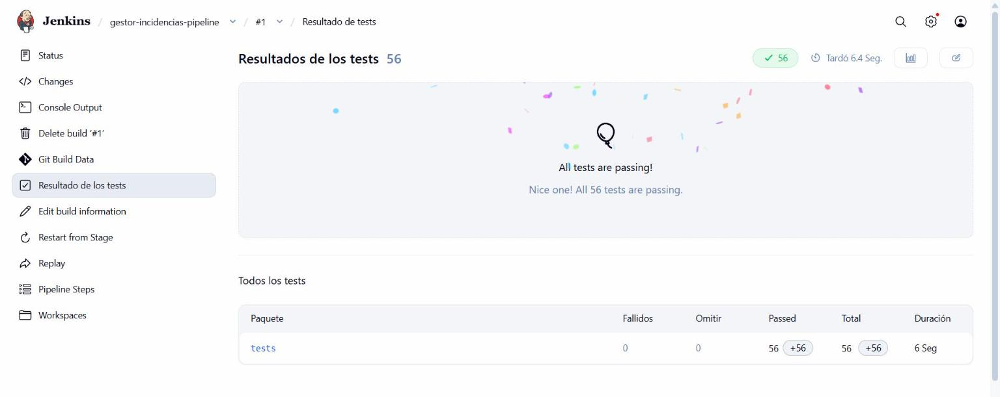
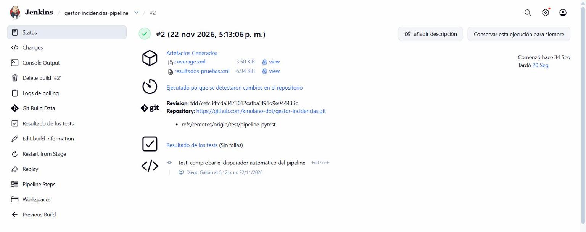
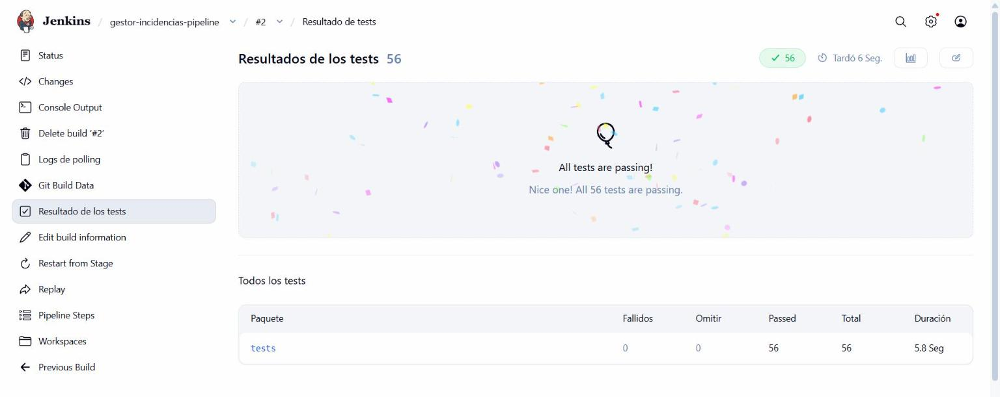

# Ejecución automática del pipeline — Gestor de Incidencias

**Responsable:** Diego Fernando Gaitán Avella
**Proyecto:** Gestor de Incidencias
**Fecha de las evidencias:** 22 de noviembre de 2026
**Alcance:** configurar que el pipeline se ejecute solo cuando cambia el repositorio y que esa ejecución corra las pruebas Pytest existentes y publique sus resultados.

## Punto de partida

Uriel dejó funcionando un agente y un `Jenkinsfile` con una sola etapa de verificación, ejecutado de forma manual y sin disparadores. Mi tarea era continuar desde ahí: que el pipeline arranque solo y que ejecute las pruebas.

Como el servidor de Uriel está en su equipo, monté uno propio para poder trabajar sin depender de que él lo tuviera encendido.

## Paso 1. Preparar la rama de trabajo

```bash
git switch main
git pull origin main
git switch -c test/pipeline-pytest
```

## Paso 2. Levantar el entorno de integración continua

La imagen oficial `jenkins/jenkins:lts` no incluye Python, así que las pruebas no podrían ejecutarse sobre ella. Preparé una imagen propia en `docker/jenkins/Dockerfile` que agrega Python, `python3-venv` y `libpq-dev`, además de los complementos necesarios.

El archivo `compose.pruebas.yaml` levanta dos servicios: el servidor Jenkins y una base PostgreSQL exclusiva para las pruebas, ambos en la misma red.

```powershell
docker compose -f compose.pruebas.yaml up -d --build
```



*Figura 1. Servidor Jenkins y base de pruebas activos.*

Mantuve este archivo separado de `docker-compose.yaml` para que una ejecución de pruebas no pueda tocar la base de desarrollo.



*Figura 2. Asistente de instalación.*



*Figura 3. Panel principal del servidor.*

## Paso 3. Mantener la etiqueta del agente acordada

El `Jenkinsfile` del equipo pide el agente con la etiqueta `gestor-incidencias`. Para no modificar esa línea y que el archivo siga sirviendo en el servidor de Uriel, asigné esa misma etiqueta al nodo de mi servidor.



*Figura 4. El nodo responde a la etiqueta `gestor-incidencias`.*

## Paso 4. Guardar la conexión a la base como credencial

Las pruebas necesitan la variable `TEST_DATABASE_URL`. Escribirla dentro del `Jenkinsfile` habría dejado una contraseña en el repositorio, así que la guardé como credencial de tipo *Secret text* con el identificador `test-database-url`, y el pipeline la pide con `credentials('test-database-url')`.



*Figura 5. La credencial se identifica por su nombre; el valor no se muestra.*

## Paso 5. Ampliar el Jenkinsfile

Conservé la etapa de verificación de Uriel y agregué tres etapas más:

| Etapa | Qué hace |
| --- | --- |
| Verificar agente | Comprueba Python, Git y Java (etapa original) |
| Instalar dependencias | Crea un entorno virtual e instala `requirements.txt` |
| Esperar base de datos | Reintenta la conexión hasta 30 veces antes de rendirse |
| Pruebas Pytest | Ejecuta las pruebas con cobertura e informe JUnit |

La etapa de espera resuelve un problema concreto: PostgreSQL tarda unos segundos en aceptar conexiones y, sin ella, el pipeline fallaba de forma intermitente según quién arrancara primero.

En el bloque `post` agregué la publicación del informe JUnit y el archivado de `resultados-pruebas.xml` y `coverage.xml`, para que los resultados queden consultables desde la interfaz y no solo en el texto de la consola.

## Paso 6. Elegir el evento y configurar el disparador

El trabajo se configuró como **Pipeline script from SCM**, apuntando al repositorio del grupo y a la rama `test/pipeline-pytest`. Así Jenkins lee el `Jenkinsfile` directamente de GitHub en lugar de tener el script pegado en la configuración.

Como disparador elegí **Consultar repositorio (SCM)** con la frecuencia `H/2 * * * *`, es decir, Jenkins revisa el repositorio cada dos minutos y lanza una ejecución solo si encuentra commits nuevos.

**Por qué este evento y no un webhook.** La opción *GitHub hook trigger* reacciona al instante, pero exige que GitHub pueda alcanzar el servidor Jenkins por internet. Nuestro servidor corre en `localhost`, de modo que GitHub no tiene cómo contactarlo sin exponer el equipo con una herramienta adicional. La consulta periódica logra el mismo resultado sin esa dependencia; la diferencia es que la ejecución empieza hasta dos minutos después del envío en lugar de inmediatamente.



*Figura 6. Consulta al repositorio cada dos minutos.*

## Paso 7. Comprobar el pipeline completo

La primera ejecución se lanzó a mano para comprobar que todas las etapas funcionaran de principio a fin.



*Figura 7. El pipeline recorre las cuatro etapas y termina en `SUCCESS`.*



*Figura 8. Resultados visibles desde la interfaz de Jenkins.*

## Paso 8. Comprobar que la ejecución es automática

Para verificar el disparador envié un commit a la rama y no toqué Jenkins. La ejecución **#2** arrancó sola.

```powershell
git commit --allow-empty -m "test: comprobar el disparador automatico del pipeline"
git push
```



*Figura 9. Jenkins indica que se ejecutó porque detectó cambios, y muestra el commit que la originó.*

La propia pantalla de la ejecución deja constancia de la causa: *«Ejecutado porque se detectaron cambios en el repositorio»*, junto con la revisión `fdd7cef` y el autor del commit.



*Figura 10. Las 56 pruebas pasan en la ejecución automática.*

## Resultados

| Dato | Valor |
| --- | --- |
| Ejecución | #2, disparada por cambios en el repositorio |
| Duración | 20 segundos |
| Pruebas ejecutadas | 56 |
| Fallos | 0 |
| Omitidas | 0 |
| Artefactos | `resultados-pruebas.xml` (6.94 KiB), `coverage.xml` (3.50 KiB) |
| Entorno | Python 3.13.5, Git 2.47.3, Java 21.0.13 |

Las 56 pruebas corresponden a las 37 funciones escritas en la entrega anterior: varias usan `@pytest.mark.parametrize` y generan más de un caso cada una.

## Resultado y límites de esta entrega

El pipeline queda ejecutándose por sí solo ante cambios en el repositorio, instalando dependencias, esperando la base de datos, corriendo las pruebas y publicando los resultados.

Conviene dejar constancia de tres límites:

- La ejecución se dispara por **consulta periódica**, no por webhook. El efecto es el mismo, pero con un retardo de hasta dos minutos.
- El servidor corre en mi equipo. Para que el resto del grupo lo use habría que alojarlo en un servidor accesible.
- El trabajo apunta a la rama `test/pipeline-pytest`. Al integrarla en `main` hay que actualizar la rama configurada en el trabajo.

**Seguridad:** no hay credenciales en el repositorio. La conexión a la base de pruebas está guardada como credencial de Jenkins y el pipeline la consulta por su identificador. Las contraseñas de la base de pruebas solo existen en el archivo de composición local y corresponden a un contenedor temporal sin datos reales.
