# Agente y pipeline manual de Jenkins — Gestor de Incidencias

**Responsable:** Uriel Andrés Rincón  
**Proyecto:** Gestor de Incidencias  
**Fecha de las evidencias:** 14 de noviembre de 2026  
**Alcance:** crear el agente, escribir el Jenkinsfile y comprobar una ejecución manual. No incluye configuración de PostgreSQL, pruebas Pytest ni disparadores automáticos.

## Paso 1. Preparar una rama independiente

Se actualizó la rama `main` desde GitHub y se creó `feature/jenkins-pipeline-grupal`, para aislar el desarrollo del pipeline del resto del repositorio.

```powershell
git switch main
git pull --ff-only origin main
git switch -c feature/jenkins-pipeline-grupal
```

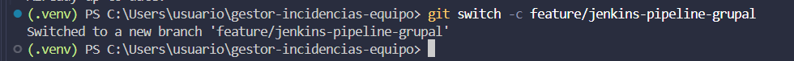

*Figura 1. Creación de la rama de trabajo.*

## Paso 2. Comprobar el servidor Jenkins existente

Se reutilizó el servidor `jenkins-laboratorio` y se iniciaron sus contenedores junto con el agente personal existente. Esta etapa no instaló un segundo servidor Jenkins.

```powershell
docker start jenkins-laboratorio
docker start jenkins-python312
docker ps --filter "name=jenkins"
```

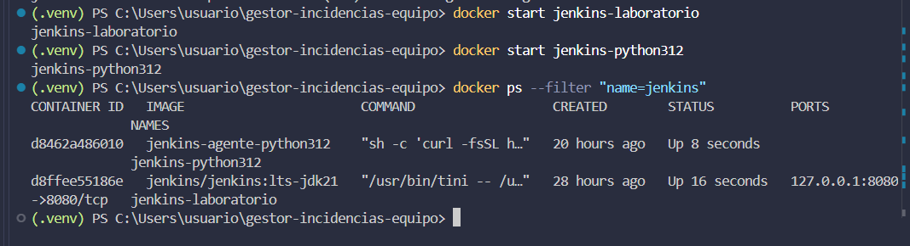

*Figura 2. Servidor y agente de laboratorio activos.*

## Paso 3. Registrar un nodo exclusivo del proyecto grupal

En **Administrar Jenkins → Nodos → Nuevo nodo**, se registró `agente-gestor-incidencias` como agente permanente, con los siguientes parámetros:

| Campo | Valor |
| --- | --- |
| Nombre | `agente-gestor-incidencias` |
| Ejecutores | `1` |
| Directorio remoto | `/home/jenkins/agent` |
| Etiqueta | `gestor-incidencias` |
| Uso | Ejecutar solo tareas vinculadas al nodo |
| Método | Iniciar el agente conectándolo al controlador (WebSocket) |

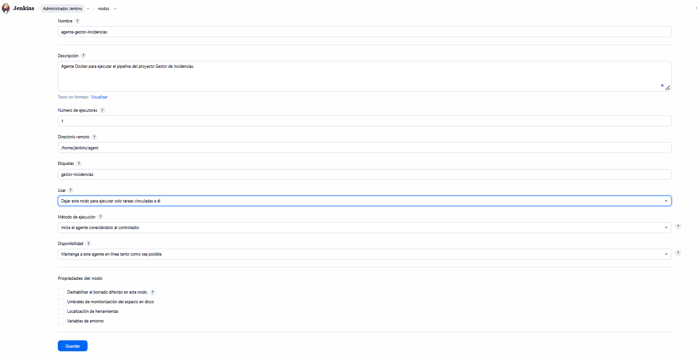

*Figura 3. Configuración del agente específico de Gestor de Incidencias.*

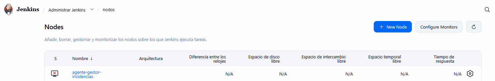

*Figura 4. El nodo queda registrado antes de iniciar su contenedor.*

## Paso 4. Comprobar la red y las herramientas del entorno

Se verificó que el servidor Jenkins y el agente de laboratorio compartían la red Docker `jenkins-lab-net`, que después utilizaría el nuevo agente. También se comprobaron las herramientas Python, Git y Java en la imagen de referencia.

```powershell
docker network inspect jenkins-lab-net --format '{{range .Containers}}{{.Name}} {{end}}'
docker exec jenkins-python312 sh -c "python --version && git --version && java -version"
```

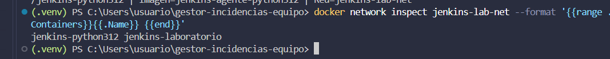

*Figura 5. Red compartida por el servidor y el agente de referencia.*

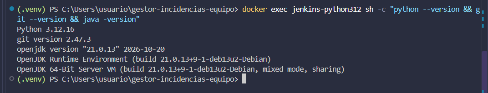

*Figura 6. Python, Git y Java disponibles en el entorno de referencia.*

## Paso 5. Crear y autenticar el contenedor del nuevo agente

Se creó el contenedor `jenkins-gestor-incidencias` en la red `jenkins-lab-net`, utilizando la imagen existente `jenkins-agente-python312`. La conexión con el controlador emplea WebSocket. La clave de autenticación se guardó en un archivo privado fuera del repositorio y se montó en el contenedor con acceso de solo lectura.

**Incidencia encontrada.** El contenedor comenzó a reiniciarse porque el archivo de autenticación contenía un texto distinto de la clave. Se corrigió el contenido del archivo y se comprobó que su formato fuera válido sin mostrar la credencial.

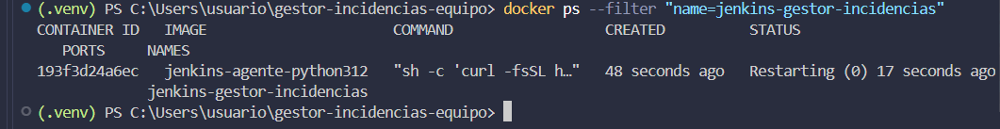

*Figura 7. Primer intento de ejecución del agente, que entró en reinicios.*

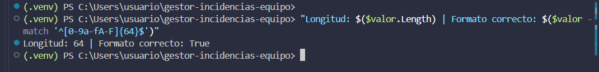

*Figura 8. Comprobación del formato de la credencial, sin revelar su contenido.*

Se inició de nuevo el contenedor y Docker lo mostró en estado `Up`.

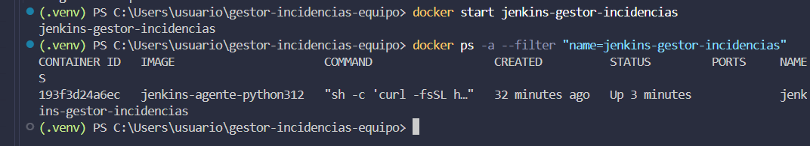

*Figura 9. Nuevo contenedor del agente en estado activo.*

Después se comprobó en **Jenkins → Nodos** que `agente-gestor-incidencias` estaba conectado, con arquitectura Linux (amd64) y el reloj sincronizado.

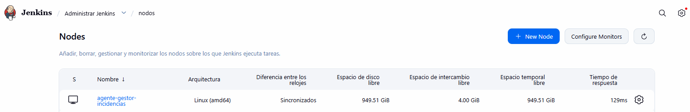

*Figura 10. Agente grupal conectado al controlador.*

## Paso 6. Crear el Jenkinsfile

Se creó un archivo `Jenkinsfile` en la raíz del proyecto para indicar a Jenkins que utilizara el agente con etiqueta `gestor-incidencias` y ejecutara una primera etapa de verificación del entorno.

```groovy
pipeline {
    agent {
        label 'gestor-incidencias'
    }
    stages {
        stage('Verificar agente') {
            steps {
                sh '''
                    echo "Agente del Gestor de Incidencias funcionando"
                    python --version
                    git --version
                    java -version
                '''
            }
        }
    }
}
```

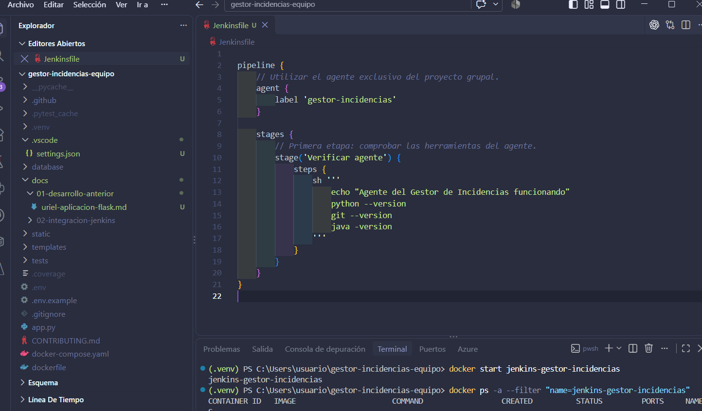

*Figura 11. Jenkinsfile inicial escrito en VS Code.*

## Paso 7. Configurar y ejecutar manualmente el pipeline

En Jenkins se creó el trabajo **Pipeline** llamado `gestor-incidencias-pipeline`. Para esta primera comprobación se eligió **Pipeline script**, se pegó el contenido del Jenkinsfile y se mantuvieron **sin seleccionar** los disparadores de ejecución automática. La opción de leer el Jenkinsfile directamente desde GitHub todavía no está configurada.

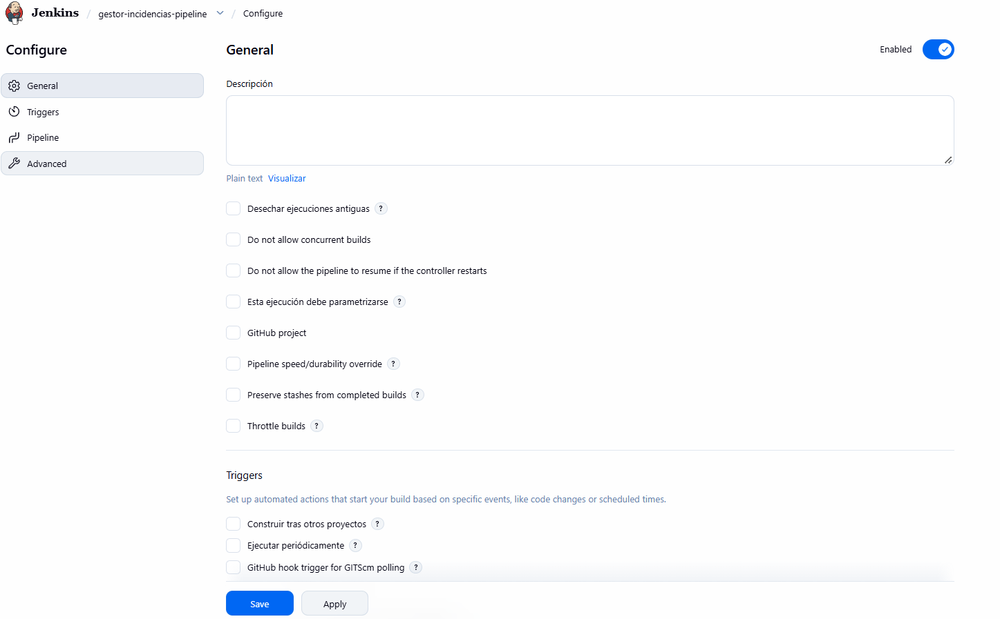

*Figura 12. Configuración sin disparadores automáticos.*

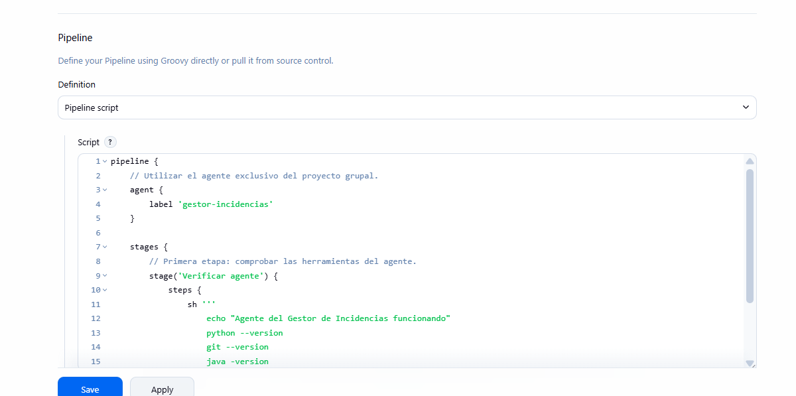

*Figura 13. Script utilizado en la prueba manual.*

Se ejecutó el pipeline desde Jenkins mediante **Build Now / Construir ahora**. La consola confirmó que se utilizó el agente `agente-gestor-incidencias` y mostró las versiones Python 3.12.16, Git 2.47.3 y Java 21.0.13. La ejecución **#1** terminó con `Finished: SUCCESS`.

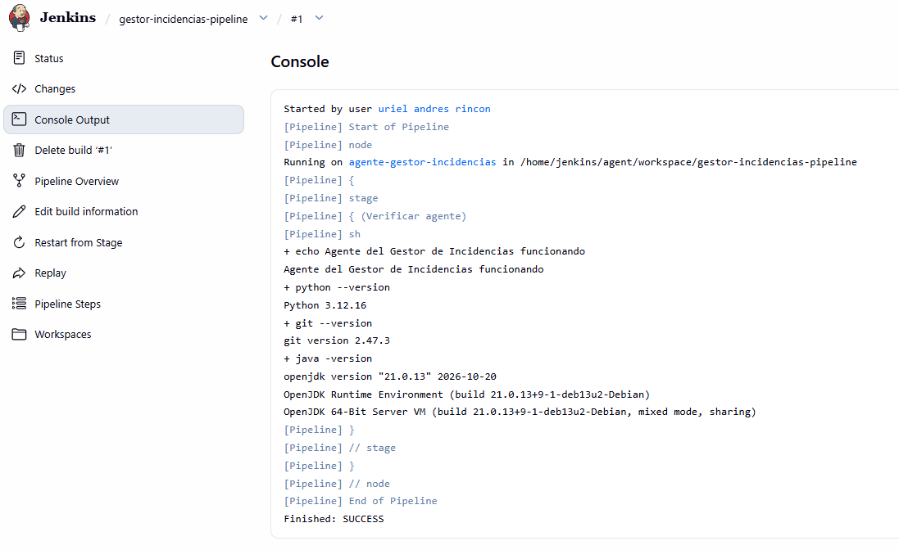

*Figura 14. Primera ejecución manual del pipeline, finalizada correctamente.*

## Resultado y límites de esta entrega

Se logró registrar y conectar un agente Docker independiente para el proyecto grupal, escribir un Jenkinsfile básico y ejecutar manualmente una etapa sobre ese agente. Esta evidencia confirma el funcionamiento del entorno Jenkins/agente, **no la ejecución de pruebas de la aplicación**.

**Trabajos pendientes de integración, por sus responsables:** lectura del Jenkinsfile desde GitHub (Silva), conexión del agente con PostgreSQL (Lina) y automatización de la ejecución con Pytest (Diego). Los archivos y ajustes correspondientes deben documentarse cuando se implementen y se comprueben.

**Seguridad:** no se incluye ninguna clave de agente en este documento ni en las imágenes.
